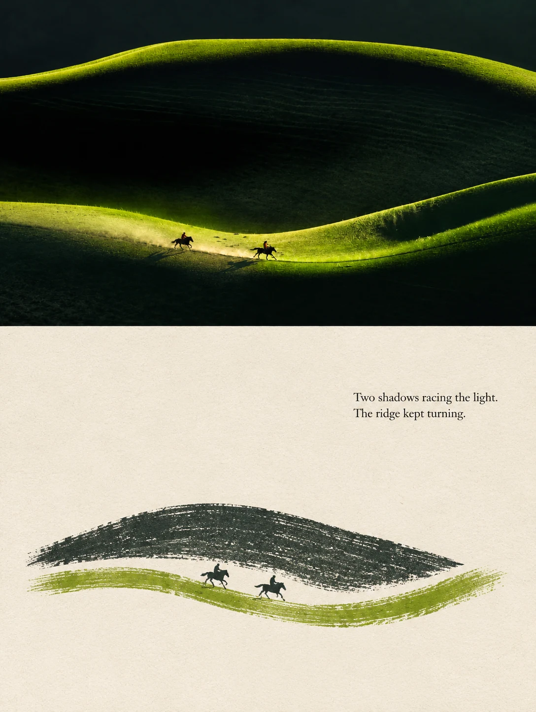
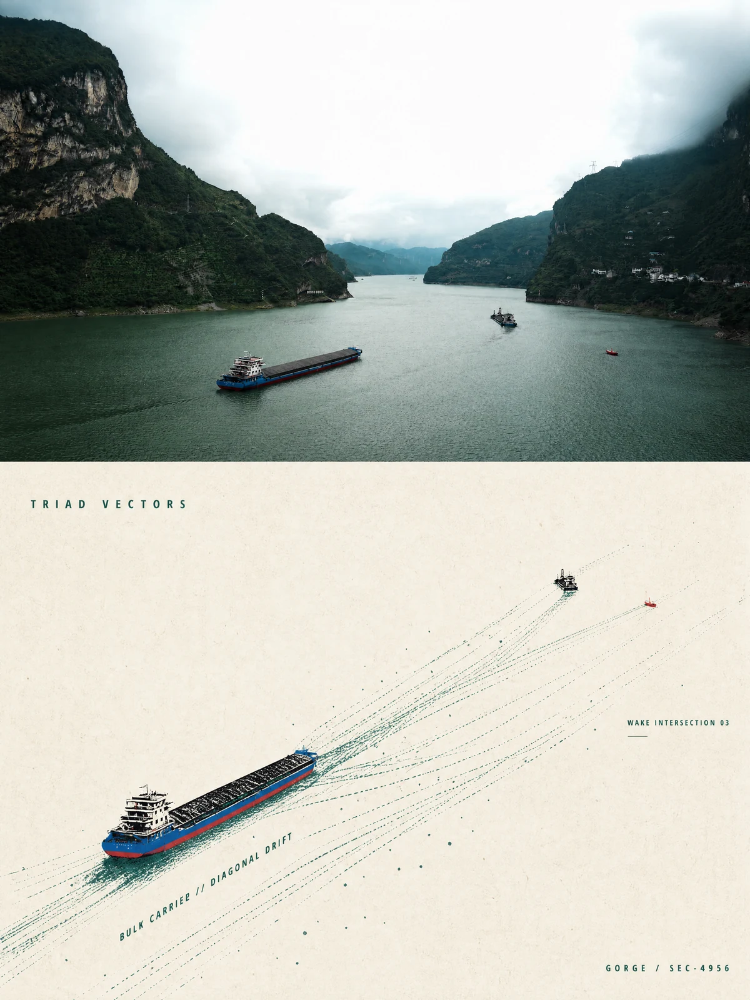
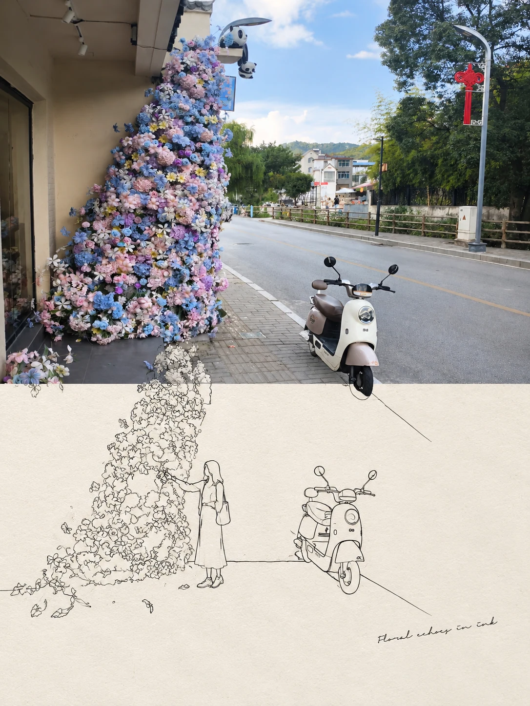

# 象塑 Xiangsu

**重塑物象，万千风格。**

象塑是一个以对话为入口的 AI 图像创作平台：上传照片或输入想法，选择创意 Skill，
与 Agent 一起生成海报、转译画面，并在同一会话中继续修改。它既提供可直接体验的浅色创作工作台，
也开放 Agent 编排、Skill 内容、模型适配、异步任务和积分结算等完整工程实现。

工程包名仍为 `ecom-forge`，不影响应用显示名称“象塑”。当前主线是 **1A 对话创作**，
不是无限画布优先的编辑器，也不要求用户先理解工作流节点。

|                               极简拼贴                                |                             虚空线稿                             |                                实景拼贴                                |
| :-------------------------------------------------------------------: | :--------------------------------------------------------------: | :--------------------------------------------------------------------: |
|  |  |  |

[作品与 Skill](#作品与-skill) · [快速启动](#快速启动) · [完成首次生图](#完成首次生图) ·
[Agent 接手指南](#agent-接手指南) · [架构](#架构) · [常见问题](#常见问题) · [开源与许可](#开源与许可)

## 项目能做什么

- **对话式生成与改图**：纯文字创作、照片艺术转译、在同一会话中继续调整结果；原照片重做与已有产物修改由不同输入绑定和服务端权限处理。
- **可扩展的创意 Skill**：Markdown 提供创作知识，manifest 提供宿主配置；按需加载辅助知识与 references，而不是在执行层写艺术风格的分支判断。
- **统一的创作方向**：Skill 原生、自动与设计师方法可参与表达；会话中的设计师选择锁定，避免多轮创作静默换人。
- **可配置的推理与图片模型**：管理台统一配置模型接口、凭据和 1K/2K/4K 积分；没有可用模型时明确阻断，不伪造成功结果。
- **长任务与恢复**：API 创建任务，独立 Worker 推进；SSE 展示进度，数据库保存状态，刷新后可恢复会话与任务。
- **真实资产与作品管理**：素材上传、附件引用、产物预览与下载；客户端不直接访问数据库、模型服务或私有文件。
- **交易与执行保护**：报价、预留、结算、幂等和调用回执分层；“结果未知”不会被当作“确定失败”自动重新投递。

**范围说明**：仓库包含后续阶段的页面、契约及模块，不表示每个页面对应的业务能力都已开放。
当前公开创意 Skill 以服务端 catalog 为准。商品白底精修、人像焕新、叙事电影海报、
写意纸境暂不公开；批量、视频、画布、社区分享和模板“做同款”不是当前 README 承诺的首版闭环。
本项目不附赠模型账户、API Key、在线演示服务或生产数据库。

## 作品与 Skill

以下 **21 张完整成图、12 个 Skill** 来自维护者本地数据库中的真实测试结果，不是图库占位图。
已获维护者公开授权，筛选时排除了清晰真实人脸、可辨个人信息与明显第三方品牌。
每张图只做适合网页展示的等比例缩小与 WebP 编码，不重新生成、局部修图或拼出虚假的前后对比。

图片可点击查看；展示版最长边不超过 1600 像素，不是 4K 原文件，也不能作为实际输出清晰度的测量依据。
上下对照图里的上半区也是最终产物的一部分，不是额外展示的原始上传文件。
一次生成的效果不能保证每次复现，结果会受到照片、提示词、模型版本和创作方向影响。

### 极简拼贴

真实风景与极简版画的上下对照，保留场景关系，压缩视觉元素。

[查看 Skill 正文](./packages/skills/content/creative-first-release-v1/skill-package/skills/minimal-scene-collage/SKILL.md)

|                                              湖畔花开                                               |                                               草原倒影                                                |                                              绿色山脊                                               |
| :-------------------------------------------------------------------------------------------------: | :---------------------------------------------------------------------------------------------------: | :-------------------------------------------------------------------------------------------------: |
|  |  |  |

### 虚空线稿

照片与实验版画并置，用疏密、线场和空间关系形成叙事。

[查看 Skill 正文](./packages/skills/content/creative-first-release-v1/skill-package/skills/void-line-poster/SKILL.md)

|                                           城市回声                                           |                                           云岭之上                                           |                                           江上行舟                                           |
| :------------------------------------------------------------------------------------------: | :------------------------------------------------------------------------------------------: | :------------------------------------------------------------------------------------------: |
|  |  |  |

### 实景拼贴

将实景照片的色彩与形状转成撕纸、印刷和拼贴材料语言。

[查看 Skill 正文](./packages/skills/content/creative-first-release-v1/skill-package/skills/creative-scene-collage/SKILL.md)

|                                          云海晨光                                          |                                        初雪天光                                        |                                          山间小屋                                          |
| :----------------------------------------------------------------------------------------: | :------------------------------------------------------------------------------------: | :----------------------------------------------------------------------------------------: |
|  |  |  |

### 敦煌壁画

上方保留真实风景，下方以矿物色、简化轮廓和壁画肌理转译。

[查看 Skill 正文](./packages/skills/content/social-art-creative-v1/skill-package/skills/dunhuang-mural-poster/SKILL.md)。当前仅收录一张实测图，不重复展示冒充多个案例。


### 实景延伸线稿

保留摄影主体，从照片边界延伸出克制而有叙事感的线稿。

[查看 Skill 正文](./packages/skills/content/creative-first-release-v1/skill-package/skills/second-world-photo-remix/SKILL.md)

|                                          日落余音                                          |                                          花开向海                                          |                                              街角花影                                              |
| :----------------------------------------------------------------------------------------: | :----------------------------------------------------------------------------------------: | :------------------------------------------------------------------------------------------------: |
|  |  |  |

### 实景转译·日常记忆页

将日常场景转成安静、具有纸面与绘画质感的记忆页面。

[查看 Skill 正文](./packages/skills/content/creative-first-release-v1/skill-package/skills/daily-memory-page/SKILL.md)

|                                       海鸟掠过                                        |                                         港口午后                                          |
| :-----------------------------------------------------------------------------------: | :---------------------------------------------------------------------------------------: |
|  |  |

### 实景拼贴-水彩

原场景与水彩速写上下对照，用透明色层和纸面留白提炼主题。

[查看 Skill 正文](./packages/skills/content/creative-first-release-v1/skill-package/skills/watercolor-scene-collage/SKILL.md)。当前仅收录一张实测图，不重复展示冒充多个案例。


### 照片意象重绘

从照片的可观察关系重新组织构图与材质，形成独立视觉表达。

[查看 Skill 正文](./packages/skills/content/creative-first-release-v1/skill-package/skills/creative-scene-reimagining/SKILL.md)。当前仅收录一张实测图，不重复展示冒充多个案例。


### 刺绣锦缎

原场景与刺绣转译上下对照，以线材、针脚方向和缎面表现层次。

[查看 Skill 正文](./packages/skills/content/social-art-creative-v1/skill-package/skills/silk-embroidery-poster/SKILL.md)。当前仅收录一张实测图，不重复展示冒充多个案例。


### 绒线微景

将场景转成可感知线材与针织结构的柔软微缩世界。

[查看 Skill 正文](./packages/skills/content/social-art-creative-v1/skill-package/skills/yarn-miniature-scene/SKILL.md)。当前仅收录一张实测图，不重复展示冒充多个案例。


### 日常反差海报

从日常照片中提炼反差主题，以明确层级和克制文字形成海报。

[查看 Skill 正文](./packages/skills/content/creative-first-release-v1/skill-package/skills/social-contrast-poster/SKILL.md)。当前仅收录一张实测图，不重复展示冒充多个案例。


### 自由创作

由用户的文字和参考决定画面，不预设必须采用哪种艺术风格。

[查看 Skill 正文](./packages/skills/content/creative-first-release-v1/skill-package/skills/creative-free-generation/SKILL.md)。当前仅收录一张实测图，不重复展示冒充多个案例。


### 其他开放 Skill

| Skill        | 当前图集情况                               | 正文                                                                                                                   |
| ------------ | ------------------------------------------ | ---------------------------------------------------------------------------------------------------------------------- |
| 青花瓷绘     | 尚无可收录的成功实测产物                   | [SKILL.md](./packages/skills/content/social-art-creative-v1/skill-package/skills/blue-white-porcelain-poster/SKILL.md) |
| 现实涂鸦     | 现有实测图含可辨第三方标识，未纳入公开图集 | [SKILL.md](./packages/skills/content/social-art-creative-v1/skill-package/skills/photo-doodle-world/SKILL.md)          |
| 粗笔艺术海报 | 现有实测图含清晰真实人脸，未纳入公开图集   | [SKILL.md](./packages/skills/content/social-art-creative-v1/skill-package/skills/bold-stroke-poster/SKILL.md)          |

没有为补齐图集自动触发付费生图。图集目录在
[`apps/web/public/showcase/catalog.json`](./apps/web/public/showcase/catalog.json)，
首页“创作精选”使用同一批静态文件：访客不需要登录即可查看，不查询生产数据库，
不包含来源用户、会话或产物 ID，也不含签名 URL。

## 快速启动

### 1. 准备环境

| 依赖             | 本仓库验证版本 / 用途               |
| ---------------- | ----------------------------------- |
| Node.js          | `22.22.3`；支持范围为 `>=22.22 <23` |
| pnpm             | `11.7.0`，由根 `package.json` 锁定  |
| Docker + Compose | 本地运行 PostgreSQL 16、Redis 7     |
| Git              | 获取源码；需要完整迁移与 Skill 资源 |

建议准备至少 8 GB 内存和足够的磁盘空间。首次安装、Worker 预构建和 Next.js 编译会较慢。
本地数据库/Redis 没有云服务费用，**真实模型请求和模型探测可能产生费用**。

克隆仓库后，在仓库根目录执行：

```bash
git clone https://github.com/yiqing168/ecom-forge.git
cd ecom-forge
corepack enable
pnpm --version
node --version
```

Windows PowerShell 如果阻止 `pnpm.ps1`，将本指南中的 `pnpm` 替换为 `pnpm.cmd`。
不要改用 npm/yarn，也不要重新生成另一套 lockfile。

### 2. 初始化本机配置

```bash
node scripts/setup-local.mjs
```

脚本以 **仓库位置** 为基准，不依赖当前终端目录，且不需要先安装项目依赖。它会：

1. 读取公开的 `.env.example`。
2. 为认证、资源、Provider 凭据、Storage 凭据、管理台和邮件摘要等密钥域分别生成独立的 32 字节随机密钥。
3. 使用与本仓库 Docker Compose 匹配的本地 PostgreSQL/Redis 连接。
4. 写入被 Git 忽略的 `.env.local`；文件已存在时保留原文件，不覆盖、不旋转密钥。

**不要直接使用模板里的 `replace-with-...` 占位值，也不要使用维护者的 `.env.local`。**
首次运行不需要真实 Provider Key；只有配置真实模型后才能实际生成图片。

#### 为什么两个 env 文件不同

| 文件                  | 是否提交 | 内容与用途                                                   |
| --------------------- | -------- | ------------------------------------------------------------ |
| `.env.example`        | 是       | 可公开的部署输入、占位符与说明；不是可直接运行的秘密配置     |
| `.env.local`          | 否       | 你自己机器的连接、密钥与域名；初始化脚本生成或由部署环境提供 |
| `runtime-defaults.ts` | 是       | 超时、队列与资源限制等 typed 默认值；不应复制到 env 文件     |

旧环境可以省略具有代码默认值的非秘密字段，所以本机文件和模板的字段数不必完全一致。
固定默认值不是“越多 env 越完整”。API 与 Worker 的 dev 入口会加载根 `.env.local`；
Next.js 前端不需要读取服务端密钥。管理台初始化等 **ops 命令须显式加载 env**，见后文。

密钥与数据库一起长期保存：更换已有 Provider、Storage、邀请码或 TOTP 加密密钥，可能使既有数据不可读。
初始化脚本不是生产部署器，生成的本地数据库口令与控制台邮件不适用于公网。

### 3. 安装、基础设施与迁移

先确认 Docker Desktop / Docker daemon 已正常启动：

```bash
pnpm install --frozen-lockfile
docker compose up -d --wait
docker compose ps
pnpm db:migrate
pnpm --filter @ecom-forge/skills... build
pnpm validate:skill-content
```

首次检出没有 `dist/`；上面的 Skill workspace 构建必须在内容校验之前完成。
它只构建 Skill 及其依赖，不需要 Provider Key。

本地 Compose 固定使用数据库 `ecom_forge`，宿主端口 5432；Redis 使用 6379。
迁移命令在未设置 `DATABASE_URL` 的本地终端使用同一 Compose 默认连接。
**若你修改了数据库连接，必须给迁移进程显式注入同一个 `DATABASE_URL`**，不能只改文件却迁移到另一个库。

自定义数据库迁移可用以下跨平台命令（不打印连接凭据）：

```bash
pnpm --filter @ecom-forge/db exec node --env-file=../../.env.local --import tsx src/migrate.ts
```

所有迁移都是向前执行；不要用数据库 reset、删除 Docker volume 或改迁移历史解决报错。

### 4. 启动服务

最简单的全仓开发入口：

```bash
pnpm dev
```

Turbo 会按 workspace 依赖完成预构建，并启动用户前端、管理台、API 和唯一 Worker。
首次 Worker 启动先构建依赖、校验内置 Skill，再加载稳定编译结果；等待日志中 `worker_ready`。

| 服务           | 本地地址                                  |
| -------------- | ----------------------------------------- |
| 用户创作工作台 | http://localhost:3000                     |
| 管理台         | http://127.0.0.1:3002                     |
| API 存活检查   | http://localhost:3001/api/v1/health/live  |
| API 就绪检查   | http://localhost:3001/api/v1/health/ready |
| PostgreSQL     | `localhost:5432`                          |
| Redis          | `localhost:6379`                          |
| 私有素材与产物 | 根 `uploads/`，不是公开静态目录           |

管理台优先使用 `127.0.0.1:3002`，与默认 `ADMIN_ORIGIN` 一致。
不要混用不同 Origin，或在运行中的 3000/3001/3002 端口上再起一套服务。

为了便于 Agent 排查，可先构建，再在 **四个独立终端** 启动：

```bash
pnpm build
```

```bash
# 终端 1
pnpm --filter @ecom-forge/api dev
```

```bash
# 终端 2，仅启动一个 Worker
pnpm --filter @ecom-forge/worker dev
```

```bash
# 终端 3
pnpm --filter @ecom-forge/web dev
```

```bash
# 终端 4
pnpm --filter @ecom-forge/admin dev
```

用户验收时使用以上稳定 API/Worker 入口；只有明确需要源码热重载时才用 `dev:watch`。
Worker 重启前先停旧进程，避免两个消费者同时处理同一环境。

### 5. 验证“已启动”

```bash
curl http://localhost:3001/api/v1/health/live
curl http://localhost:3001/api/v1/health/ready
```

Windows PowerShell 使用 `curl.exe`，或 `Invoke-RestMethod`。

`live` 返回 200 只表示 API 进程可响应；`ready` 还检查数据库、Redis、队列恢复状态与
API/Worker 的内置 Skill catalog 一致性。刚启动时 `ready` 可能短暂返回 503。
首页可打开、静态案例可看，不等于已经有模型可生成，也不等于模型准入已完成。

## 完成首次生图

全新数据库**没有维护者的管理员、用户、邀请码、模型 Key 或积分配置**。
按以下顺序完成真实创作闭环，不要导入维护者的数据库备份。

### 1. 创建首位管理员

在仓库根的交互终端运行：

```bash
pnpm --filter @ecom-forge/api exec node --env-file=../../.env.local --import tsx src/ops/bootstrap-admin.ts
```

根据提示设置管理员标识、显示名称、至少 12 位密码，将一次性 TOTP URI 绑定到认证器，
输入当前验证码，并输入 `CREATE` 完成确认。恢复码只显示一次，请在私密密码库保管；
不要把密码、TOTP 或恢复码写进 issue、README 或 shell 命令参数。

这个命令不是 `pnpm dev`，不会自动加载根 env；命令中的 `--env-file` 不能省略。
没有默认管理员密码，也没有绕过 MFA 的后门。

### 2. 配置 Provider 域名与模型

先在私密 `.env.local` 中配置你自己供应商的允许域名，例如：

```dotenv
PROVIDER_RELAY_ORIGINS=https://api.your-provider.example
PROVIDER_IMAGE_OUTPUT_ORIGINS=https://images.your-provider.example
```

这里是 **HTTPS Origin**，不含 `/v1` 或 `/images/generations` 路径。
多个允许项按对应配置格式以逗号分隔；图片下载域名未必与模型 API 域名相同。
不要为了请求跑通关闭 SSRF/域名限制。设置后重启 API 和唯一 Worker。

随后打开管理台“模型配置”：

1. 添加一个支持工具调用/结构化交互的**推理模型**，填写真实接口地址、协议与 write-only Key，获取模型列表后选择模型。
2. 添加一个**生图模型**。要体验照片类 Skill，模型与适配器必须支持带参考图的改图，不是只支持无图生成。
3. 对生图模型显式保存 1K/2K/4K 积分；4K 价格不从其他档位猜测。
4. 检查模型状态与创作端模型目录；仅保存一条连接信息不代表所有能力均已准入。

兼容协议不等于能力相同。供应商必须实际支持所选模型、生成/编辑请求、尺寸、
输出格式和响应语义。代码不会因为名称叫 `gpt-image-2` 就绕过验证。
协议/准入背景见 [Provider 文档](./docs/03-provider-poc-and-cost-model.md) 和
[管理台 SPEC](./docs/spec/S14-user-center-and-minimal-admin-console.md)。

模型列表探测会访问供应商；后续准入/实际生图可能收费。脚本初始化、普通单元测试和静态展示不调用付费 Provider。
内容安全与结果审核属于独立发布门，审核能力缺失时须按报错配置，不要关掉门禁来伪装跑通。

### 3. 配置注册入口与积分

在管理台“邀请码”页面：

1. 开启并设置合适的“注册送积分”，**在注册测试用户之前**保存。
2. 生成可用邀请码。
3. 在用户工作台注册邮箱并完成邮箱验证码验证。

本地 `MAIL_PROVIDER=console` 不会发送真实邮件。验证码在 **API 终端** 的 `[DEV MAIL]` 中，
不是 Worker 日志。生产环境必须换成受支持的真实邮件服务，不能公开控制台验证码。

未配置或关闭注册送积分时，新用户不自动获得可消费积分；无法生图不代表模型失败。
不要直接 UPDATE 余额或伪造账本来“初始化”，资金必须经过正式信用服务。

### 4. 生成第一张图

推荐先从低费用的小请求验证：

1. 打开工作台，选好推理模型、生图模型。
2. 测无参考图时选择“自由创作”，输入具体构图、主体与材质，选择 1K、1 张。
3. 测照片转译时上传你有权使用的照片，选择“极简拼贴”或其他照片类 Skill，再发送。
4. 等待会话中的任务结果，查看完整图，并测试一次同会话继续修改。

首页精选只提供视觉参考和对应 Skill 的创作入口，不把其他人的来源产物加入你的附件，
也不提交原始案例 prompt。真实输入必须来自你自己的文字/授权图片。

## Agent 接手指南

其他编码 Agent 接手时，先读取根 [AGENTS.md](./AGENTS.md) 和涉及目录内的 scoped instructions。
**不要把运行成功的标准简化为“3000 返回 200”。**

```text
1. git status --short；保留已有改动，不清理或重置用户文件。
2. 核对 Node / pnpm 版本及 Docker 状态；不擅自升级核心依赖。
3. 若 .env.local 不存在，执行 node scripts/setup-local.mjs；
   若已存在，保留密钥，只核对缺失字段，绝不输出完整 env。
4. 安装锁定依赖、启动 PG/Redis、迁移、校验内置 Skill。
5. 检查服务端口；启动 API、唯一 Worker、Web、Admin，等待 worker_ready。
6. 验证 live 与 ready；分开报告页面可访问和模型可执行。
7. 管理员初始化必须由维护者在交互终端设置密码/TOTP。
8. 真实模型 Key、允许域名与积分由部署者配置；禁止借用维护者数据。
9. 明确获得付费请求授权后，才做真实模型诊断或生图。
10. 回报地址、已通过检查、未验证项；不擅自提交、推送或公开仓库。
```

### 测试与门禁

```bash
# 初始化工具测试，不需要数据库或模型
node --test scripts/setup-local.test.mjs

# 工程门禁
pnpm check
pnpm build
pnpm validate:skill-content
pnpm validate:golden-eval-gate

# 需要本地 PG/Redis 的集成与 Worker 检查
pnpm test:integration
pnpm test:worker

# 安装 Chromium 后运行 mock 浏览器回归
pnpm exec playwright install chromium
pnpm test:e2e
```

`pnpm check` 包含格式、lint、typecheck、单元/相关数据库测试及工程验证。
测试 runner 会隔离测试数据库，Docker 基础设施需要运行。
默认浏览器 E2E 在 3100 启动专属 Web 并拦截测试 API，不复用你的 3000，不调用真实生图模型。
如果 3100 已有服务，应先确认其归属，不直接杀掉别人的进程。

工程 golden gate 和 mock 浏览器测试**不等于艺术质量、真实供应商连通性或生产部署验收**。
进行真实验证时明确模型、费用授权和结果，不把未运行的检查写成已通过。

## 架构

| 目录                        | 职责                                             |
| --------------------------- | ------------------------------------------------ |
| `apps/web`                  | Next.js 用户工作台、交互、API/SSE 客户端         |
| `apps/admin`                | 独立管理台、邀请码、模型与存储配置               |
| `apps/api`                  | NestJS 认证、权限、HTTP/SSE、交易与状态入口      |
| `apps/worker`               | BullMQ 消费、Agent 编排、Provider 调用、产物处理 |
| `packages/agent`            | turn、上下文、工具循环、Skill runtime            |
| `packages/compiler`         | 确定性计划校验、引用授权、收费动作检查           |
| `packages/skills`           | 通用创作 Markdown、宿主 manifest 与评测          |
| `packages/provider`         | 供应商适配、模型快照、三态回执与成本             |
| `packages/credit`           | 报价预留、结算与唯一资金流水入口                 |
| `packages/db`               | Drizzle schema、PostgreSQL 迁移                  |
| `packages/queue`            | 队列契约、幂等 job 与调度基础                    |
| `packages/storage`          | 私有资源存储、安全路径与能力校验                 |
| `packages/types` / `shared` | 契约类型、无副作用工具、精确金额计算             |

技术栈：TypeScript、pnpm workspace、Turbo、Next.js、React、NestJS、
PostgreSQL、Drizzle、Redis、BullMQ、Vitest、Supertest、Playwright。

```text
用户指令 / 授权图片
        |
     Web -> API -> Agent 队列
                         |
                      Worker
                         |
                Agent + 按需 Skill
                         |
                 确定性 Compiler
                         |
               报价 / 权限 / 积分预留
                         |
                     Provider
                         |
           产物验证 / 审核 / 私有存储 / 结算
                         |
               数据库 + event_outbox
                         |
                    SSE -> Web
```

推理模型负责理解任务、创作规划和工具参数；生图模型负责图像实现。
当前不会默认将所有 Skill 全文原样投给生图模型，所有生成仍经过宿主执行边界。
数据与资金是服务端真相，不由 LLM、React 或 BullMQ 重试次数决定。

### 增加或修改 Skill

Skill 正文必须是可脱离本工程使用的通用知识，不夹带固定工具输出或平台交易协议。

```text
packages/skills/content/<content-package>/skill-package/
  skill-package.json
  skills/<skill-slug>/SKILL.md
  evals/<skill-slug>.jsonl
  references/                       # 按需或共享知识才拆分
```

- 修改已列入资源清单的内置正文：编辑内容、补风险对应的评测、校验，然后重启 API 和唯一 Worker。
- 不必手动维护固定 hash、byte_size 或为措辞调整递增版本；启动在内存中按实际文件重算内容身份。
- 新增/删除资源、修改目录、执行类型、依赖或 Preset：更新 manifest 与评测，保持宿主配置和通用正文分离。
- 不靠额外的 `if (skillSlug === ...)` 在 Agent/Compiler/Provider 中实现艺术知识。
- 外部 Skill 包仍走隔离、内容校验、审批、发布链路，不能覆盖同名内置 Skill。

参考 [Skill 包规则](./packages/skills/AGENTS.md) 和 [编排契约](./docs/02-agent-and-skill-orchestration-contract.md)。

## 常见问题

| 现象                                           | 优先排查                                                                                |
| ---------------------------------------------- | --------------------------------------------------------------------------------------- |
| 拉下来启动就报 secret 缺失                     | 运行初始化脚本；模板占位符不是密钥。确认 API/Worker 从正确 package 目录启动并加载根 env |
| ops 提示 secret 缺失                           | 交互命令显式加 `--env-file=../../.env.local`，不要在命令参数中塞密钥                    |
| 数据库或 Redis 连接失败                        | Docker 是否运行、容器是否 healthy、端口是否冲突；自定义连接是否也注入迁移进程           |
| Docker Desktop 报 Unix socket / inference 错误 | 先修复 Docker 自身启动；这是基础设施故障，不是 Skill 或生图模型错误，勿 reset 项目数据  |
| 首页有图、发送却没有可用模型                   | 静态图集不依赖 Provider；在管理台配置推理/图片模型、准入和积分，检查公开 catalog        |
| 注册收不到邮件                                 | 本地控制台模式查看 API 的 `[DEV MAIL]`；生产检查真实邮件配置                            |
| 新用户没有积分                                 | 注册前是否开启注册送积分；后补配置不会追改已注册用户的账本                              |
| 管理台 403 / 无法登录                          | 使用默认管理台 Origin、检查 Host/来源 allowlist、管理员和 TOTP，勿关闭安全校验          |
| 有任务但一直不推进                             | 是否只有一个正确环境的 Worker、是否出现 `worker_ready`、Redis prefix 是否一致           |
| 修改 Skill 后仍用旧内容                        | 重启 API 与 Worker；只重启 Web 不够；先等当前生成结束，不在运行中切内容                 |
| 生成接口超时                                   | 检查任务回执；未知结果不得盲目重投，否则可能重复计费                                    |
| 放大展示图显得不清晰                           | README/首页为缩小 WebP；检查真实下载产物的像素与请求尺寸，不把预览当 4K 文件            |
| 想“清理后重新跑”                               | 不执行 `git reset --hard`、删 volume 或数据库 reset；先定位配置/迁移与日志原因          |

## 部署与安全

本地启动不是生产部署。上线前至少完成：

- HTTPS、真实部署 Origin、严格可信代理与管理台网络隔离；本地 Compose 端口不要直接暴露公网。
- 独立 secret/keyring 管理、受控备份、实际邮件服务、Provider 域名允许列表。
- 私有资源鉴权、生命周期与审核、日志脱敏、数据库备份及恢复演练。
- 为 API/Worker 注入各自最小环境集；生产 Worker 显式配置消费开关，不靠本地 dev 脚本。
- 真实模型准入、尺寸与计费验证；高档位、取消和未知回执路径专项验收。
- 更新用户协议、隐私与生成内容版权说明，复核实际目标地区的合规要求。

详细文档：[架构与部署](./docs/10-engineering-architecture-and-deployment.md)、
[安全与资产生命周期](./docs/08-security-compliance-and-asset-lifecycle.md)、
[验证与运维](./docs/09-validation-and-operations.md)。
文档冲突按照 [docs/README.md](./docs/README.md) 的裁决优先级处理。

## 开源与许可

第一方代码、文档与 Skill 内容使用 [MIT License](./LICENSE)。
改编的第三方资源保留原许可证及 NOTICE，见 [THIRD_PARTY_NOTICES.md](./THIRD_PARTY_NOTICES.md)。
作品展示授权不等于授予原照片、人物、品牌的权利，也不保证模型输出可不经审查商用。

发布时不要包含 `.env.local`、真实 Key、私有 `uploads/`、数据库备份、
`imgage/`、诊断日志、`docs/research/` 的本地研究报告或受控截图。
`.gitignore` 只作用于未跟踪文件，**不能清除已提交记录或 Git 历史中的秘密**。
旧研究报告已停止跟踪，但仍可能存在于本地历史。首次公开发布建议从验收后的提交
导出源码到独立目录，再创建新的 GitHub 初始提交，不上传本机旧历史；不要删除本仓库的 `.git`。
公开仓库前应单独检查完整提交历史与已有跟踪文档；本次 README 更新不是历史泄密审计。

建议提交前执行：

```bash
git status --short
git diff --check
pnpm format:check
git ls-files .env.local uploads imgage docs/research
```

最后一个命令只是列出需要人工复核的已跟踪路径，不应自动删除这些文件。
提交需遵循 [AGENTS.md](./AGENTS.md) 的审查与用户验收要求。

### GitHub 创建仓库时怎么填

- **Repository name**：`ecom-forge`，应用名称为“象塑 Xiangsu”，无须批量改 workspace 包名。
- **Description**：`象塑：重塑物象，万千风格。基于对话 Agent 与可扩展 Skill 的 AI 图像创作平台，支持照片艺术转译、多轮改图和自部署。`
- **Topics**：`ai`, `image-generation`, `ai-agent`, `skills`, `photo-editing`, `nextjs`, `nestjs`, `typescript`, `self-hosted`。
- README 与 LICENSE 已在本仓库准备，不需要在 GitHub 创建时额外生成一套文件。
- 先完成敏感数据与历史检查，再决定公开；不要将“建好仓库”和“验证生产可上线”混为一谈。
